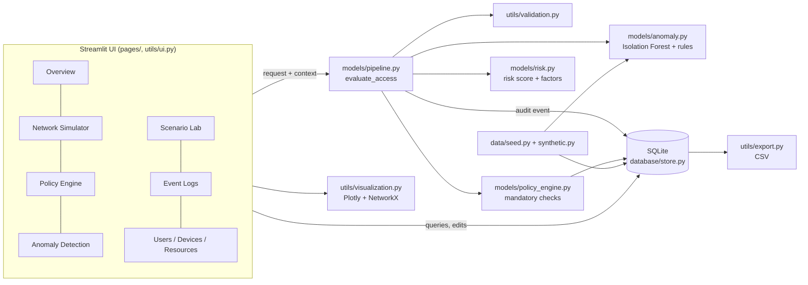

# Architecture

## Component diagram

## Flow of one access request
1. **Validate** - request fields (ID format, request type) and behavioural context (ranges, no NaN). A malformed
   request is *denied and logged*, never silently dropped.
2. **Resolve** - look up user, device and resource in SQLite. Missing entities become failed checks.
3. **Mandatory checks** (`policy_engine.evaluate_policy`): user/device/resource exist; account active; identity
   verified; device active; device compliant (if the policy requires it); device belongs to the user; resource
   active; role listed on the resource; an enabled policy grants this category, sensitivity and request type;
   time window (if the policy is business-hours-only). Network location is *never* an input.
4. **Risk score** (`risk.score_risk`): transparent additive factors (failed sign-ins, unusual hour, request-rate
   deviation, resource spread, failed-request ratio, resource sensitivity, stale device verification), capped at 100.
5. **Anomaly result** (`anomaly.analyze`): Isolation Forest score plus transparent rules. "Detected" means the model
   *or* the rules fired. If training failed, rules alone are used.
6. **Decide** (`pipeline.decide`, pure function):

| Rule | Condition | Decision |
|---|---|---|
| R1 | any mandatory check failed | DENY (risk and anomaly are informational only) |
| R2 | risk >= deny threshold (default 70) | DENY |
| R3 | risk >= flag threshold (default 35) or anomaly detected | FLAG - permitted, flagged for review |
| R4 | otherwise | ALLOW |

7. **Explain** - plain-English reason built from the failed check, the main risk factors or the triggered rules.
8. **Persist** - the event (all fields, JSON for checks and factors) is inserted with parameterised SQL.
9. **Display** - pages re-query SQLite; dashboard numbers are never stored separately from the events.

## Design decisions
- *Why pure functions?* `decide`, `evaluate_policy`, `score_risk` take plain dicts, so they are easy to unit test and
  deterministic for identical inputs and policy settings.
- *Why retrain instead of pickle?* Loading pickles can execute arbitrary code. Training takes about a second with fixed
  seeds, so the model is rebuilt each start and results are reproducible.
- *Why union of model and rules?* The forest generalises beyond fixed thresholds; the rules are explainable and also
  catch cases the forest misses (for example the forest's recall on "resource sweep" windows is lower than the rules').
  The union can only add scrutiny, never access.
- *Idempotent seeding:* entities use `INSERT OR IGNORE`; demo events are written once together with a `demo_seeded`
  setting in one transaction, so Streamlit reruns and restarts never duplicate data.
- *Deactivate, don't delete:* audit rows keep valid references.
- *Safety:* parameterised SQL, whitelisted table/column names, no `eval`/`exec`, no credentials stored.
